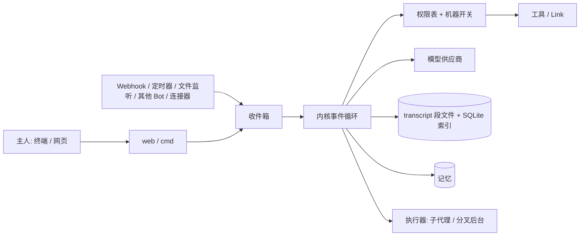

# XBot：新人导览

> **30 秒版**：XBot 是用 Go 从零写的个人 AI 助手，给一个主人在自己的机器上长期使用。交互单位是 **Bot**：一个有名字、有记忆、长期存在的实体，同一个主题只找一个 Bot，上下文一直连着，系统里没有"会话"。Bot 能在没人叫它时醒来，判断有没有值得告诉主人的事；能在授权的机器上做主人在终端里能做的事。终端和网页是同一条对话的两个入口。

## 愿景与思想
> 已确认（2026-10-16，主人确认）。

Bot 是第三代交互模型。第一代是 Chat，第二代是 Session 和 Agent，第三代是 Bot：一个有记忆、长期存在的实体。主人不需要管理会话，也不需要 `--resume`；想聊哪件事，就去找负责这件事的那个 Bot。

Bot 有主动性。webhook、文件监听、其他 Bot、定时器都能唤醒它；它自己判断有没有值得说的事，有就说，没有就保持安静（回复 `SILENT`）。免打扰时段照样生效。主动性靠评测保证：看行为和结果，不看模型自己的汇报——自己设定目标，被打断后继续同一件事，做不到时停下来说明原因。

内核要薄，机制最小够用。不为特殊情况加规则，新能力尽量用已有的抽象（Link、Event、收件箱、执行器任务）表达。例如插话分叉的后台直接登记成执行器任务，确认规则收拢在一张权限表里。

Bot 是全能的。授权给它的机器，它能做主人在终端里能做的任何事。隔离靠部署方式，安全靠操作审核和保险箱，不靠假装能限制文件访问。

主人希望 Bot 任何时候都能在几秒内回应，哪怕它正忙着长任务，这是当前在做的「插话时分叉」。接下来是开源网关、P2P 和跨用户通信（M8）。进度见 [MILESTONES](https://github.com/liu-zhengdong/xbot/blob/main/docs/MILESTONES.md)。

## 你需要知道的术语
| 术语 | 白话解释 | 代码里叫 |
|---|---|---|
| Bot | 一个长期存在、有记忆的助手实体 | `bot.Bot` |
| Link | Bot 和外界之间的任何通道：出站是工具，入站是事件 | `link` |
| Event | 统一的事件结构 `{source, type, content, sender, time}` | `inbox` |
| transcript | 每个 Bot 一份只追加、带 seq 编号的原文记录 | `bot/transcript.go` |
| 主人（owner） | 拥有并授权 Bot 的人；只有主人经认证入口发的消息算可信 | `person` |
| 执行器任务 | 子代理和分叉后台共用的任务记录（`agents/<id>/`） | `exec` |

## 组成
| 部分 | 一句话 | 什么时候读 | 文档 |
|---|---|---|---|
| 内核 | Link、Event、收件箱、事件循环 | 改一轮对话怎么跑、事件怎么进来 | [kernel.md](kernel.md) |
| 上下文与 transcript | 固定前缀、分段存储、索引、压缩、找回、导出 | 改 `internal/bot/transcript.go`、压缩、导出 | [context.md](context.md) |
| 身份与记忆 | 人、三层记忆、冲突规则 | 改 `internal/memory`、`internal/person` | [memory.md](memory.md) |
| 子代理 | 后台子代理与执行者 | 改 `internal/exec`、`internal/agent` | [subagents.md](subagents.md) |
| 插话时分叉 | 插话时一轮分成前台和后台 | 做 F1–F5，改分支、前后台调度 | [fork.md](fork.md) |
| 多 Bot | 主 Bot、分组、Fork Bot、Bot 间通信、档案、例程 | 改 `internal/bot`、`internal/peer`、`internal/cron` | [multibot.md](multibot.md) |
| 机器与设备 | 机器开关、多节点、隧道、浏览器、桌面 | 改 `internal/machine`、`node`、`browser`、`desktop` | [machines.md](machines.md) |
| 生态 | 内置 Link、MCP、技能、连接器、编码代理 | 加 Link、改 MCP、技能或编码代理 | [ecosystem.md](ecosystem.md) |
| 安全 | 保险箱、出站代理、权限表 | 加工具（必须在权限表归类）、改确认规则 | [security.md](security.md) |
| 模型供应商与评测 | 供应商、模型提示、认证、主动性评测 | 改 `internal/provider`、`internal/eval`、`evals/` | [providers.md](providers.md) |
| 网页界面 | 对话、轨迹、确认卡、侧边栏 | 改 `internal/web` 和静态界面 | [ui.md](ui.md) |
| 版本与自动升级 | 版本注入、发布脚本、检查与应用升级、优雅重起 | 改 `internal/version`、`internal/upgrade`、`scripts/release.sh` | [release.md](release.md) |
| 网关 | 开源网关、P2P、Bot 地址（计划中） | 做 M8 | [gateway.md](gateway.md) |

## 怎么配合

所有输入都变成 Event 进收件箱，每个 Bot 一个事件循环按顺序处理。一轮里内核组装上下文、调模型、把工具调用交给权限表审查后执行，所有结果只追加进 transcript。

**走查：主人在网页上发一句「帮我看看这个 bug」。**
1. 网页 `POST /api/bots/{name}/messages` 接住（[internal/web/server.go](https://github.com/liu-zhengdong/xbot/blob/main/internal/web/server.go)），认证后成为可信事件。
2. 内核拿到处理锁，组装上下文：固定前缀（人设、规则、Link 说明）+ 摘要块 + 未压缩的尾巴 + 有变化时的环境更新（[context.md](context.md)）。
3. 调用绑定的模型（[internal/provider](https://github.com/liu-zhengdong/xbot/blob/main/internal/provider/)）；回复里的多个工具调用并行执行。
4. 每个工具调用先过权限表和机器开关（[security.md](security.md)）；读文件、shell 读命令直接跑，删除或对外发送弹确认卡，卡片也写进 transcript。
5. 结果按调用顺序追加进 transcript，SSE 流式回网页；轨迹进信息面板（[ui.md](ui.md)）。
6. 如果这一轮很长、主人又插了一句，这一轮分叉成后台继续，前台几秒内回答（[fork.md](fork.md)）。

## 文档地图
| 文档 | 在哪 | 给谁 | 活的 / 冻结 | 谁维护 |
|---|---|---|---|---|
| 项目说明与构建 | [README.md](https://github.com/liu-zhengdong/xbot/blob/main/README.md) | 所有人 | 活的 | 主人 |
| Agent 入口 | [AGENTS.md](https://github.com/liu-zhengdong/xbot/blob/main/AGENTS.md) | 编码 Agent | 活的 | 主人 |
| 里程碑与进度 | [MILESTONES.md](https://github.com/liu-zhengdong/xbot/blob/main/docs/MILESTONES.md) | 主人、开发者 | 活的，天天变 | Bot 复刻 |
| 网页 HTTP 接口 | [API.md](https://github.com/liu-zhengdong/xbot/blob/main/docs/API.md) | 界面开发者 | 活的 | 开发者 |
| 决策记录 | [docs/adr/](adr/index.html) | 开发者、将来的主人 | 守护层，只追加 | 主人 |
| 旧设计入口 | [DESIGN.md](https://github.com/liu-zhengdong/xbot/blob/main/docs/DESIGN.md) | — | 已并入 atlas，只留指针 | — |
| 模型提示 | [prompts/models/README.md](https://github.com/liu-zhengdong/xbot/blob/main/prompts/models/README.md) | 调提示的人 | 活的 | 开发者 |
| 模型提示正文 | [deepseek-chat.md](https://github.com/liu-zhengdong/xbot/blob/main/prompts/models/deepseek/deepseek-chat.md) | 模型 | 活的 | 开发者 |

## 全局要求：性能与界面流畅
- 链路不传大块数据：只传摘要或流式传输；每次节点调用上限 1 MiB，处处设大小上限。
- 交互回复 p95 < 3 秒；本机进程间通信（IPC）额外开销 p95 < 5 毫秒；后台导致的变慢不超过 10%。
- 界面：60fps；动画只动 transform/opacity，时长不超过 200 毫秒；遵守 prefers-reduced-motion；轮询不能引起重排、卡顿或抢焦点。
- 每个里程碑验收都要报性能数字。

ADR 一览：[0001 多个后台](adr/0001-multiple-backgrounds.md)、[0002 前台写操作自动排队](adr/0002-foreground-writes-auto-queue.md)、[0003 一张权限表](adr/0003-one-permission-table.md)、[0004 去掉主动性三档](adr/0004-drop-proactivity-levels.md)。
